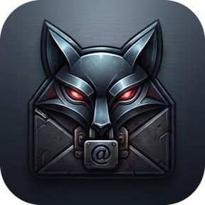
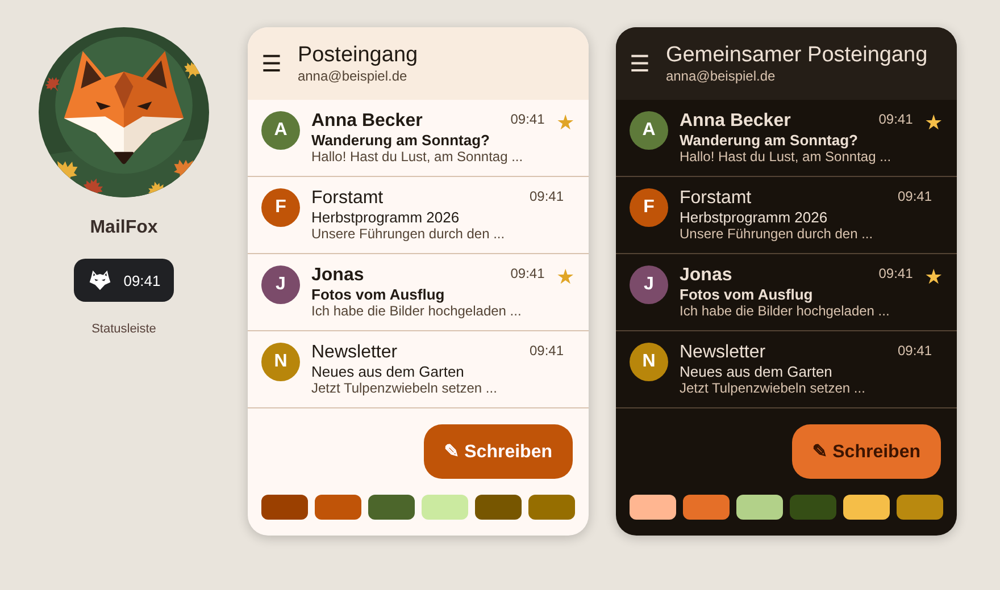

# MailFox

Persönliche Variante von [K-9 Mail](https://github.com/thunderbird/thunderbird-android) (Thunderbird for Android) mit
herbstlichem Farbthema, eigenem Fuchs-Icon und schnellem Wechsel zwischen den Posteingängen.

MailFox hat eine eigene Paket-ID (`io.github.haigerman.mailfox`) und lässt sich daher **neben K-9 Mail** installieren.

## Unterschiede zu K-9 Mail



- **Farbthema „Herbstfuchs“** (hell und dunkel): Fuchs-Orange, Moosgrün und Herbstgold auf warmem Creme bzw. dunklem
  Rindenbraun – in den klassischen Ansichten und in den Compose-Bildschirmen. Auch die Farben der Wischgesten in der
  Nachrichtenliste und der Stern sind herbstlich.
- **App-Icon:** geometrischer Fuchskopf vor Waldgrün mit Ahornblättern (adaptives Icon, inkl. einfarbiger Variante für
  „Designte Symbole“ ab Android 13)
- **Statusleisten-Icon:** Fuchskopf-Silhouette für Benachrichtigungen (neue Nachrichten, Push-Dienst usw.)
- **Posteingang wechseln per Tipp auf den Titel:** Ein Tipp auf „Posteingang“ oben in der Nachrichtenliste schaltet
  der Reihe nach durch – gemeinsamer Posteingang (falls aktiviert) → Posteingang Konto 1 → Konto 2 → … → wieder von
  vorne. Die Reihenfolge entspricht der Kontenliste im Menü.
- App-Name „MailFox“

## Installation und Updates

Fertige, signierte APKs liegen unter [Releases](https://github.com/haigerman/mailfox/releases).
Mit [Obtainium](https://obtainium.imranr.dev/) einfach die Repository-URL `https://github.com/haigerman/mailfox`
hinzufügen – dann kommen Updates automatisch.

### Umzug von K-9 Mail

K-9 Mail: *Einstellungen → Einstellungen exportieren*, dann in MailFox: *Einstellungen → Einstellungen importieren*.
Passwörter werden dabei nicht übertragen und müssen in MailFox neu eingegeben werden.

### Kein OAuth

MailFox unterstützt keine OAuth-Anmeldung („Mit Google/Microsoft anmelden“). Die OAuth-Zugänge von K-9 Mail sind an
dessen App-ID und Signaturschlüssel gebunden und funktionieren in MailFox ohnehin nicht. Deshalb ist OAuth ausgebaut:
keine OAuth-Anbieter, keine Auswahl „OAuth 2.0“ bei den Server-Einstellungen und keine OAuth-Weiterleitung im Manifest.

Konten mit Benutzername/Passwort (bzw. App-Passwort) – z. B. GMX, Web.de, Posteo, mailbox.org, IONOS, eigener Server –
funktionieren ganz normal. Werden K-9-Einstellungen mit einem OAuth-Konto importiert, meldet MailFox „OAuth wird nicht
unterstützt“; das Konto lässt sich in den Server-Einstellungen auf Passwort-Anmeldung umstellen.

## Neue Version veröffentlichen

1. Datei `VERSION` erhöhen (Format `X.Y.Z`) und auf `main` pushen.
2. Der Workflow [MailFox Release](.github/workflows/mailfox-release.yml) baut die APK, signiert sie und legt das
   Release `vX.Y.Z` an. Manuell starten geht unter *Actions → MailFox Release → Run workflow*.

`versionCode` = `X*10000 + Y*100 + Z`. Die Hauptversion folgt der zugrunde liegenden K-9-Version
(MailFox 25.0.x basiert auf K-9 Mail 25.0).

Benötigte Repository-Secrets (wie bei den anderen Apps): `KEYSTORE_BASE64`, `KEYSTORE_PASSWORD`, `KEY_ALIAS`,
`KEY_PASSWORD` (alternativ mit Präfix `SIGNING_`).

## Upstream-Updates übernehmen

MailFox enthält die vollständige Git-Historie von K-9 Mail. Neue K-9-Versionen werden per Merge übernommen:

```bash
git remote add upstream https://github.com/thunderbird/thunderbird-android.git   # einmalig
git fetch upstream release --tags
git merge K9MAIL_26_0          # Tag der gewünschten K-9-Version
```

Danach `VERSION` auf die neue Hauptversion setzen (z. B. `26.0.0`).

Typische Konflikte und wie man sie löst:

| Datei | Lösung |
|---|---|
| `.github/workflows/*`, `.github/dependabot.yml` | gelöscht lassen (`git rm`) |
| `app-k9mail/src/main/res/values-*/strings.xml` | gelöscht lassen (App-Name wird nicht übersetzt) |
| `app-k9mail/src/{debug,release}/kotlin/app/k9mail/auth/K9OAuthConfigurationFactory.kt` | gelöscht lassen (kein OAuth) |
| `app-k9mail/build.gradle.kts` (versionCode/versionName) | MailFox-Variante behalten |
| `README.md` | MailFox-Variante behalten |

Alle MailFox-Änderungen im Code sind mit `MailFox` kommentiert (`git grep -n MailFox`). Die meisten liegen in eigenen
Dateien, damit Merges möglichst konfliktfrei bleiben:

- Farben: `app-k9mail/src/main/res/values/mailfox_theme_colors.xml` und
  `app-k9mail/src/main/kotlin/app/k9mail/provider/MailFoxThemeColors.kt` (erzeugt mit `docs/mailfox/theme_colors.mjs`)
- Icons: `app-k9mail/src/main/res/drawable*/` (erzeugt mit `docs/mailfox/icon/android.py`)
- Posteingang-Wechsel: `legacy/ui/legacy/src/main/java/com/fsck/k9/activity/InboxCycler.kt` und `MessageHomeActivity.kt`

## Bauen

Voraussetzungen: JDK 21 und das Android SDK (Platform 37).

```bash
./gradlew :app-k9mail:assembleFossDebug
```

Die APK liegt danach unter `app-k9mail/build/outputs/apk/foss/debug/`. Debug-Builds haben die Paket-ID
`io.github.haigerman.mailfox.debug`.

## Lizenz

MailFox basiert auf K-9 Mail / Thunderbird for Android und steht wie das Original unter der
[Apache License 2.0](LICENSE).
